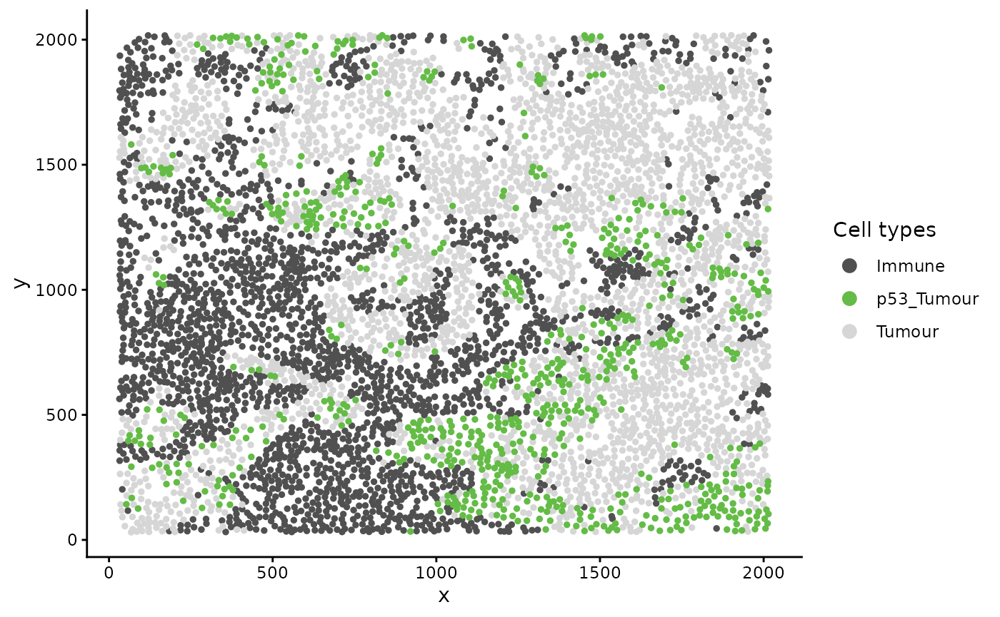
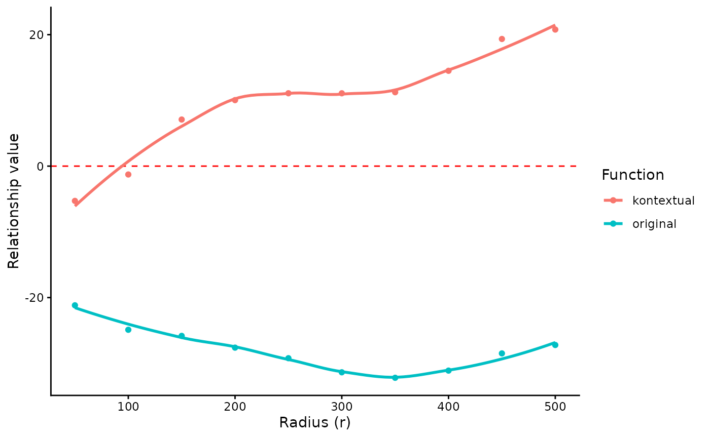
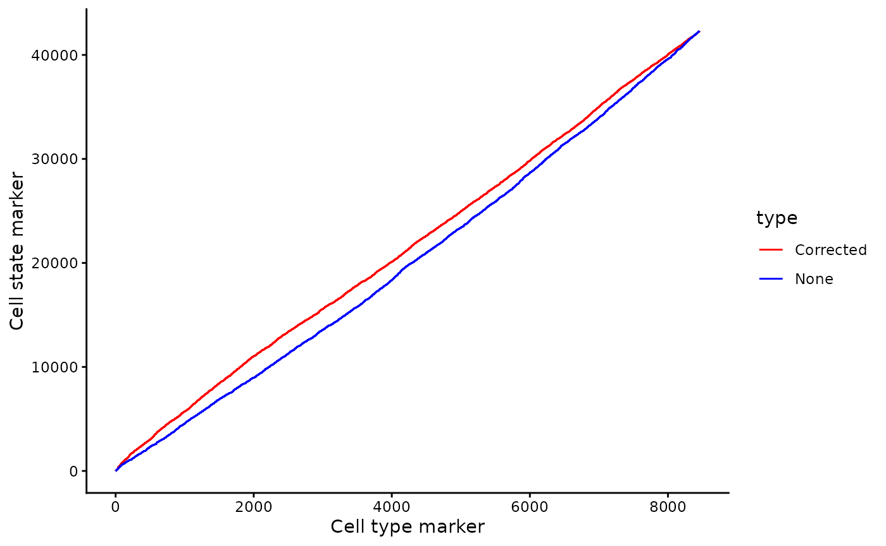
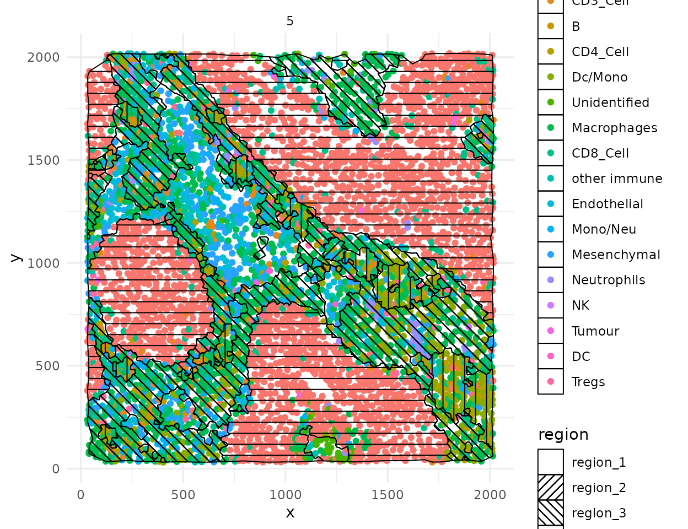
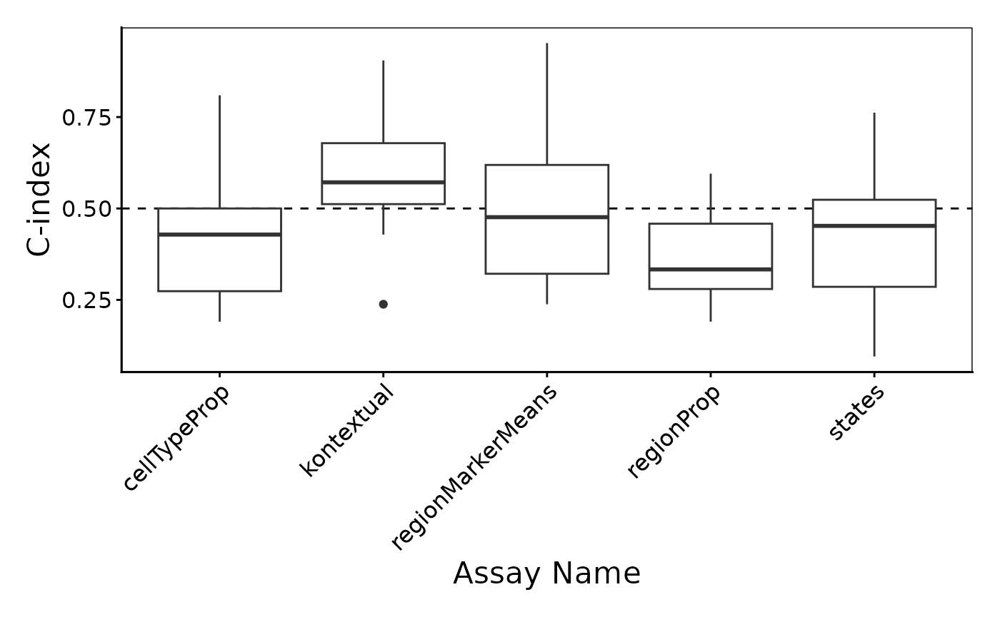

# Statial

## Installation

``` r

# Install the package from Bioconductor
if (!requireNamespace("BiocManager", quietly = TRUE)) {
  install.packages("BiocManager")
}
BiocManager::install("Statial")
```

## Load packages

``` r

# Loading required packages
library(Statial)
library(spicyR)
library(ClassifyR)
library(lisaClust)
library(dplyr)
library(SingleCellExperiment)
library(ggplot2)
library(ggsurvfit)
library(survival)
library(treekoR)

theme_set(theme_classic())
```

## Overview

There are over 37 trillion cells in the human body, each taking up
different forms and functions. The behaviour of these cells can be
described by canonical characteristics, but their functions can also
dynamically change based on their environmental context. Understanding
the interplay between cells is key to understanding their mechanisms of
action and how they contribute to human disease. `Statial` is a suite of
functions to quantify the spatial relationships between cell types. This
guide will provide a step-by-step overview of some key functions within
`Statial`.

## Loading example data

To illustrate the functionality of Statial we will use a multiplexed ion
beam imaging by time-of-flight (MIBI-TOF) dataset profiling tissue from
triple-negative breast cancer patients$`^1`$ by Keren et al., 2018. This
dataset simultaneously quantifies *in situ* expression of 36 proteins in
34 immune rich patients. *Note:* The data contains some “uninformative”
probes and the original cohort included 41 patients.

These images are stored in a `SingleCellExperiment` object called
`kerenSCE`. This object contains 57811 cells across 10 images and
includes information on cell type and patient survival.

*Note:* The original dataset was reduced down from 41 images to 10
images for the purposes of this vignette, due to size restrictions.

``` r

# Load breast cancer
data("kerenSCE")

kerenSCE
#> class: SingleCellExperiment 
#> dim: 48 57811 
#> metadata(0):
#> assays(1): intensities
#> rownames(48): Na Si ... Ta Au
#> rowData names(0):
#> colnames(57811): 1 2 ... 171281 171282
#> colData names(8): x y ... Survival_days_capped Censored
#> reducedDimNames(1): z
#> mainExpName: NULL
#> altExpNames(0):
```

## Kontextual: Context aware spatial relationships

`Kontextual` is a method for performing inference on cell localisation
which explicitly defines the contexts in which spatial relationships
between cells can be identified and interpreted. These contexts may
represent landmarks, spatial domains, or groups of functionally similar
cells which are consistent across regions. By modelling spatial
relationships between cells relative to these contexts, `Kontextual`
produces robust spatial quantifications that are not confounded by
biases such as the choice of region to image and the tissue structure
present in the images.

In this example we demonstrate how cell type hierarchies can be used as
a means to derive appropriate “contexts” for the evaluation of cell
localisation. We then demonstrate the types of conclusions which
`Kontextual` enables.

### Using cell type hierarchies to define a “context”

A cell type hierarchy may be used to define the “context” in which cell
type relationships are evaluated within. A cell type hierarchy defines
how cell types are functionally related to one another. The bottom of
the hierarchy represents homogeneous populations of a cell type (child),
the cell populations at the nodes of the hierarchy represent broader
parent populations with shared generalised function. For example CD4 T
cells may be considered a child population to the Immune parent
population.

There are two ways to define the cell type hierarchy. First, they can be
defined based on our biological understanding of the cell types. We can
represent this by creating a named list containing the names of each
parent and the associated vector of child cell types.

*Note:* The `all` vector must be created to include cell types which do
not have a parent e.g. the *undefined* cell type in this data set.

``` r

# Examine all cell types in image
unique(kerenSCE$cellType)
#>  [1] "Keratin_Tumour" "CD3_Cell"       "B"              "CD4_Cell"      
#>  [5] "Dc/Mono"        "Unidentified"   "Macrophages"    "CD8_Cell"      
#>  [9] "other immune"   "Endothelial"    "Mono/Neu"       "Mesenchymal"   
#> [13] "Neutrophils"    "NK"             "Tumour"         "DC"            
#> [17] "Tregs"

# Named list of parents and their child cell types
biologicalHierarchy = list(
  "tumour" = c("Keratin_Tumour", "Tumour"),
  "tcells" = c("CD3_Cell", "CD4_Cell", "CD8_Cell", "Tregs"),
  "myeloid" = c("Dc/Mono", "DC", "Mono/Neu", "Macrophages", "Neutrophils"),
  "tissue" = c("Endothelial", "Mesenchymal")
)

# Adding more broader immune parent populationse
biologicalHierarchy$immune = c(biologicalHierarchy$tcells,
                               biologicalHierarchy$myeloid,
                               "NK", "other immune", "B")


# Creating a vector for all cellTypes
all <- unique(kerenSCE$cellType)
```

Alternatively, you can use the `treeKor` bioconductor package
[treekoR](http://www.bioconductor.org/packages/release/bioc/html/treekoR.md)
to define these hierarchies in a data driven way.

*Note:* These parent populations may not be accurate as we are using a
small subset of the data.

``` r

# Calculate hierarchy using treekoR
kerenTree <- getClusterTree(t(assay(kerenSCE, "intensities")),
                            kerenSCE$cellType,
                            hierarchy_method="hopach",
                            hopach_K = 1)

# Convert treekoR result to a name list of parents and children.
treekorParents = getParentPhylo(kerenTree)

treekorParents
#> $parent_1
#> [1] "Dc/Mono"     "Macrophages" "NK"         
#> 
#> $parent_2
#> [1] "CD3_Cell" "B"        "CD4_Cell" "CD8_Cell" "Tregs"   
#> 
#> $parent_3
#> [1] "Endothelial" "Mesenchymal" "DC"         
#> 
#> $parent_4
#> [1] "Unidentified" "other immune" "Mono/Neu"     "Neutrophils"  "Tumour"
```

### Application on triple negative breast cancer image.

Here we examine an image highlighted in the Keren et al. 2018 manuscript
where accounting for context information enables new conclusions. In
image 6 of the Keren et al. dataset, we can see that *p53+ tumour cells*
and *immune cells* are dispersed i.e. these two cell types are not
mixing. However we can also see that *p53+ tumour cells* appear much
more localised to *immune cells* relative to the tumour context (*tumour
cells* and *p53+ tumour cells*).

``` r

# Lets define a new cell type vector
kerenSCE$cellTypeNew <- kerenSCE$cellType

# Select for all cells that express higher than baseline level of p53
p53Pos <- assay(kerenSCE)["p53", ] > -0.300460

# Find p53+ tumour cells
kerenSCE$cellTypeNew[kerenSCE$cellType %in% biologicalHierarchy$tumour] <- "Tumour"
kerenSCE$cellTypeNew[p53Pos & kerenSCE$cellType %in% biologicalHierarchy$tumour] <- "p53_Tumour"

# Group all immune cells under the name "Immune"
kerenSCE$cellTypeNew[kerenSCE$cellType %in% biologicalHierarchy$immune] <- "Immune"

# Plot image 6
kerenSCE |>
  colData() |>
  as.data.frame() |>
  filter(imageID == "6", cellTypeNew %in% c("Immune", "Tumour", "p53_Tumour")) |>
  arrange(cellTypeNew) |>
  ggplot(aes(x = x, y = y, color = cellTypeNew)) +
  geom_point(size = 1) +
  scale_colour_manual(values = c("Immune" = "#505050", "p53_Tumour" = "#64BC46", "Tumour" = "#D6D6D6")) +
  guides(colour = guide_legend(title = "Cell types", override.aes = list(size = 3)))
```



`Kontextual` accepts a `SingleCellExperiment` object, a single image, or
list of images from a `SingleCellExperiment` object, which gets passed
into the `cells` argument. The two cell types which will be evaluated
are specified in the `to` and `from` arguments. A parent population must
also be specified in the `parent` argument, note the parent cell
population must include the `to` cell type. The argument `r` will
specify the radius which the cell relationship will be evaluated on.
`Kontextual` supports parallel processing, the number of cores can be
specified using the `cores` argument. `Kontextual` can take a single
value or multiple values for each argument and will test all
combinations of the arguments specified.

We can calculate these relationships across all images for a single
radius (r = 100). Small radii will examine local spatial relationships,
whereas larger radii will examine global spatial relationships.

``` r

p53_Kontextual <- Kontextual(
  cells = kerenSCE,
  r = 100,
  from = "Immune",
  to = "p53_Tumour",
  parent = c("p53_Tumour", "Tumour"),
  cellType = "cellTypeNew"
)

p53_Kontextual
#>    imageID               test   original  kontextual   r inhomL
#> 1        1 Immune__p53_Tumour -16.212016  -1.6815952 100  FALSE
#> 2       14 Immune__p53_Tumour -14.671281  -4.2879138 100  FALSE
#> 3       18 Immune__p53_Tumour  -1.953366   0.5795853 100  FALSE
#> 4       21 Immune__p53_Tumour -14.300802  -7.1425133 100  FALSE
#> 5       29 Immune__p53_Tumour -20.728463  -7.0172785 100  FALSE
#> 6        3 Immune__p53_Tumour   1.719549  44.5060581 100  FALSE
#> 7       32 Immune__p53_Tumour -18.174569 -10.8972277 100  FALSE
#> 8       35 Immune__p53_Tumour -75.980619 -66.2395276 100  FALSE
#> 9        5 Immune__p53_Tumour         NA          NA 100  FALSE
#> 10       6 Immune__p53_Tumour -24.897348  -1.2724241 100  FALSE
```

The `kontextCurve` function plots the L-function value and Kontextual
values over a range of radii. If the points lie above the red line
(expected pattern) then localisation is indicated for that radius, if
the points lie below the red line then dispersion is indicated.

As seen in the following plot the L-function produces negative values
over a range of radii, indicating that *p53+ tumour cells* and *immune
cells* are dispersed from one another. However by taking into account
the tumour context, `Kontextual` shows positive values over some radii,
indicating localisation between *p53+ tumour cells* and *immune cells*.

``` r

curves <- kontextCurve(
  cells = kerenSCE,
  from = "Immune",
  to = "p53_Tumour",
  parent = c("p53_Tumour", "Tumour"),
  rs = seq(50, 510, 50),
  image = "6",
  cellType = "cellTypeNew"
)

kontextPlot(curves)
```



Alternatively all pairwise cell relationships and their corresponding
parent in the dataset can be tested. A data frame with all pairwise
combinations can be creating using the `parentCombinations` function.
This function takes in a vector of all the cells, as well as the named
list of parents and children created earlier in the `parentList`
argument. As shown below the output is a data frame specifying the `to`,
`from`, and `parent` arguments for `Kontextual`.

*Note:* the output of `getPhyloParent` may also be using the in the
`parentList` argument, for example if you wanted to use the treekoR
defined hierarchy instead.

``` r

# Get all relationships between cell types and their parents
parentDf <- parentCombinations(
  all = all,
  parentList = biologicalHierarchy
)
```

### Calculating all pairwise relationships

Rather than specifying `to`, `from`, and `parent` in `Kontextual`, the
output from `parentCombinations` can be inputed into `Kontextual` using
the `parentDf` argument, to examine all pairwise relationships in the
dataset. This chunk will take a significant amount of time to run, for
demonstration the results have been saved and are loaded in.

``` r

# Running Kontextual on all relationships across all images.
kerenKontextual <- Kontextual(
  cells = kerenSCE,
  parentDf = parentDf,
  r = 100
)
```

For every pairwise relationship (named accordingly: `from__to__parent`)
`Kontextual` outputs the L-function values (original) and the Kontextual
value. The relationships where the L-function and Kontextual disagree
(e.g. one metric is positive and the other is negative) represent
relationships where adding context information results in different
conclusions on the spatial relationship between the two cell types.

``` r

head(kerenKontextual, 10)
#>    imageID                      test   original  kontextual   r inhomL
#> 1        1 Keratin_Tumour__B__immune -32.547645 -20.8129718 100  FALSE
#> 2       14 Keratin_Tumour__B__immune         NA          NA 100  FALSE
#> 3       18 Keratin_Tumour__B__immune  -2.879684  -0.4266132 100  FALSE
#> 4       21 Keratin_Tumour__B__immune         NA          NA 100  FALSE
#> 5       29 Keratin_Tumour__B__immune         NA          NA 100  FALSE
#> 6        3 Keratin_Tumour__B__immune -36.175444 -15.4940620 100  FALSE
#> 7       32 Keratin_Tumour__B__immune -43.187880 -40.6868426 100  FALSE
#> 8       35 Keratin_Tumour__B__immune -66.782273 -46.2862443 100  FALSE
#> 9        5 Keratin_Tumour__B__immune -68.676955 -46.3064625 100  FALSE
#> 10       6 Keratin_Tumour__B__immune -31.393046  -0.4636465 100  FALSE
```

### Associating the relationships with survival outcomes.

To test whether Kontextual relationships are associated with patient
outcomes, or differ between groups of patients, use `kontextualTest`. It
takes the same `parentDf` as `Kontextual` and a `condition`: here a
`Surv` column of survival outcomes.

``` r

# add survival column to kerenSCE
kerenSCE$event = 1 - kerenSCE$Censored
kerenSCE$survival = Surv(kerenSCE$Survival_days_capped, kerenSCE$event)

# one survival value per image, named by image
first <- !duplicated(kerenSCE$imageID)
kerenSurv <- setNames(kerenSCE$survival[first], kerenSCE$imageID[first])
```

`kontextualTest` does not compare the Kontextual values themselves
between patients. In each image it compares the Kontextual statistic
with its exact expectation if the `to` cells were a random choice among
the cells of their parent population, so that differences in tissue
composition between patients do not by themselves look like changes in
the relationship. The images’ excesses over this expectation are then
related to survival with patients as the units (see
[`?kontextualTest`](https://sydneybiox.github.io/Statial/reference/kontextualTest.md)).
With several images per patient, give the patient column as `subject`.

``` r

# Testing every relationship in parentDf against survival
survivalResults <- kontextualTest(
  cells = kerenSCE,
  parentDf = parentDf,
  condition = "survival",
  r = 100
)

topPairs(survivalResults)
#>                                   intercept coefficient    p.value adj.pvalue
#> Macrophages__Neutrophils__immune         NA  -1.8533448 0.00460055  0.8498842
#> Macrophages__Neutrophils__myeloid        NA  -1.5310536 0.02856114  0.8498842
#> other immune__CD3_Cell__tcells           NA  -0.6822973 0.03408181  0.8498842
#> other immune__Tumour__tumour             NA  -1.4551809 0.04308263  0.8498842
#> Endothelial__other immune__immune        NA   0.6276215 0.04633332  0.8498842
#> CD3_Cell__Endothelial__tissue            NA   0.4882285 0.07411592  0.8498842
#> Endothelial__Mono/Neu__myeloid           NA          NA 0.07437390  0.8498842
#> CD8_Cell__Neutrophils__myeloid           NA   0.7352861 0.08174464  0.8498842
#> Tumour__CD3_Cell__immune                 NA  -0.5220534 0.09322871  0.8498842
#> CD3_Cell__Tumour__tumour                 NA  -0.8669941 0.09756879  0.8498842
#>                                           from           to  parent
#> Macrophages__Neutrophils__immune   Macrophages  Neutrophils  immune
#> Macrophages__Neutrophils__myeloid  Macrophages  Neutrophils myeloid
#> other immune__CD3_Cell__tcells    other immune     CD3_Cell  tcells
#> other immune__Tumour__tumour      other immune       Tumour  tumour
#> Endothelial__other immune__immune  Endothelial other immune  immune
#> CD3_Cell__Endothelial__tissue         CD3_Cell  Endothelial  tissue
#> Endothelial__Mono/Neu__myeloid     Endothelial     Mono/Neu myeloid
#> CD8_Cell__Neutrophils__myeloid        CD8_Cell  Neutrophils myeloid
#> Tumour__CD3_Cell__immune                Tumour     CD3_Cell  immune
#> CD3_Cell__Tumour__tumour              CD3_Cell       Tumour  tumour
```

The results can also be visualised using the `signifPlot` function, with
a panel for each parent population.

``` r

signifPlot(survivalResults)
```


With 10 patients, 0 relationships are significant after correcting for
the number of relationships tested (BH-adjusted p \< 0.05). The most
significant is Macrophages\_\_Neutrophils\_\_immune, the relationship
between Macrophages and Neutrophils relative to the parent population
immune (p = 0.0046). Its coefficient, the log hazard ratio for a
standard deviation increase in the Kontextual excess, is -1.9: patients
whose Macrophages and Neutrophils cells are more localised relative to
the immune population tend to have better survival.

The association can be visualised on a Kaplan-Meier curve. The
Kontextual values of every relationship in every image are in a wide
matrix from `prepMatrix`; note, to extract the original L-function
values, specify `column = "original"` in `prepMatrix`.

``` r

# Converting Kontextual result into data matrix
kontextMat <- prepMatrix(kerenKontextual)

# In the order of the survival vector, for the Kaplan-Meier curve below
kontextMat <- kontextMat[names(kerenSurv), ]

# Replace NAs with 0
kontextMat[is.na(kontextMat)] <- 0
```

We then classify each image as localised or dispersed by comparing its
Kontextual value for this relationship with the median, and plot a
Kaplan-Meier curve using the `ggsurvfit` package.

``` r

# The most significant relationship
survRelationship <- kontextMat[[topName]]
survRelationship <- ifelse(survRelationship > median(survRelationship), "Localised", "Dispersed")

# Plotting Kaplan-Meier curve
survfit2(kerenSurv ~ survRelationship) |>
  ggsurvfit() +
  ggtitle(topName)
```


## SpatioMark: Identifying continuous changes in cell state

Changes in cell states can be analytically framed as the change in
abundance of a gene or protein within a particular cell type. We can use
marker expression to identify and quantify evidence of cell interactions
that catalyse cell state changes. This approach measures how protein
markers in a cell change with spatial proximity and abundance to other
cell types. The methods utilised here will thereby provide a framework
to explore how the dynamic behaviour of cells are altered by the agents
they are surrounded by.

### Continuous cell state changes within a single image

The first step in analysing these changes is to calculate the spatial
proximity (`getDistances`) and abundance (`getAbundances`) of each cell
to every cell type. These values will then be stored in the
`reducedDims` slot of the `SingleCellExperiment` object under the names
`distances` and `abundances` respectively.

``` r

kerenSCE <- getDistances(kerenSCE,
  maxDist = 200
)

kerenSCE <- getAbundances(kerenSCE,
  r = 200
)
```

First, let’s examine the same effect observed earlier with Kontextual -
the localisation between p53-positive keratin/tumour cells and
macrophages in the context of total keratin/tumour cells for image 6 of
the Keren et al. dataset.

Statial provides two main functions to assess this relationship -
`calcStateChanges` and `plotStateChanges`. We can use `calcStateChanges`
to examine the relationship between 2 cell types for 1 marker in a
specific image. In this case, we’re examining the relationship between
keratin/tumour cells (`from = Keratin_Tumour`) and macrophages
(`to = "Macrophages"`) for the marker p53 (`marker = "p53"`) in
`image = "6"`. We can appreciate that the `fdr` statistic for this
relationship is significant, with a negative tvalue, indicating that the
expression of p53 in keratin/tumour cells decreases as distance from
macrophages increases.

``` r

stateChanges <- calcStateChanges(
  cells = kerenSCE,
  image = "6",
  from = "Keratin_Tumour",
  to = "Macrophages",
  marker = "p53"
)

stateChanges
#>   imageID primaryCellType otherCellType marker         coef      tval
#> 1       6  Keratin_Tumour   Macrophages    p53 -0.001402178 -7.010113
#>           pval          fdr
#> 1 2.868257e-12 2.868257e-12
```

Statial also provides a convenient function for visualising this
interaction - `plotStateChanges`. Here, again we can specify `image = 6`
and our main cell types of interest, keratin/tumour cells and
macrophages, and our marker p53, in the same format as
`calcStateChanges`.

Through this analysis, we can observe that keratin/tumour cells closer
to a group of macrophages tend to have higher expression of p53, as
observed in the first graph. This relationship is quantified with the
second graph, showing an overall decrease of p53 expression in
keratin/tumour cells as distance to macrophages increase.

These results allow us to essentially arrive at the same result as
Kontextual, which calculated a localisation between p53+ keratin/tumour
cells and macrophages in the wider context of keratin/tumour cells.

``` r

p <- plotStateChanges(
  cells = kerenSCE,
  image = "6",
  from = "Keratin_Tumour",
  to = "Macrophages",
  marker = "p53"
)

p
#> $image
```


    #> 
    #> $scatter


### Continuous cell state changes across all images

Beyond looking at single cell-to-cell interactions for a single image,
we can also look at all interactions across all images. The
`calcStateChanges` function provided by Statial can be expanded for this
exact purpose - by not specifying cell types, a marker, or an image,
`calcStateChanges` will examine the most significant correlations
between distance and marker expression across the entire dataset. Here,
we’ve filtered out the most significant interactions to only include
those found within image 6 of the Keren et al. dataset.

``` r

stateChanges <- calcStateChanges(
  cells = kerenSCE,
  minCells = 100
)

stateChanges |>
  filter(imageID == 6) |>
  head(n = 10)
#>    imageID primaryCellType otherCellType       marker         coef      tval
#> 1        6  Keratin_Tumour  Unidentified           Na  0.004218419  25.03039
#> 2        6  Keratin_Tumour   Macrophages  HLA_Class_1 -0.003823497 -24.69629
#> 3        6  Keratin_Tumour      CD4_Cell  HLA_Class_1 -0.003582774 -23.87797
#> 4        6  Keratin_Tumour  Unidentified Beta.catenin  0.005893120  23.41953
#> 5        6  Keratin_Tumour      CD8_Cell  HLA_Class_1 -0.003154544 -23.13804
#> 6        6  Keratin_Tumour       Dc/Mono  HLA_Class_1 -0.003353834 -22.98944
#> 7        6  Keratin_Tumour      CD3_Cell  HLA_Class_1 -0.003123446 -22.63197
#> 8        6  Keratin_Tumour        Tumour  HLA_Class_1  0.003684079  21.94265
#> 9        6  Keratin_Tumour      CD4_Cell           Fe -0.003457338 -21.43550
#> 10       6  Keratin_Tumour      CD4_Cell   phospho.S6 -0.002892457 -20.50767
#>             pval           fdr
#> 1  6.971648e-127 1.179045e-123
#> 2  7.814253e-124 1.238950e-120
#> 3  1.745242e-116 2.213665e-113
#> 4  1.917245e-112 2.262171e-109
#> 5  5.444541e-110 6.005093e-107
#> 6  1.053130e-108 1.113158e-105
#> 7  1.237988e-105 1.207895e-102
#> 8  8.188258e-100  7.041347e-97
#> 9   1.287478e-95  9.749473e-93
#> 10  3.928912e-88  2.588796e-85
```

In image 6, the majority of the top 10 most significant interactions
occur between keratin/tumour cells and an immune population, and many of
these interactions appear to involve the HLA class I ligand.

We can examine some of these interactions further with the
`plotStateChanges` function. Taking a closer examination of the
relationship between macrophages and keratin/tumour HLA class I
expression, the plot below shows us a clear visual correlation - as
macrophage density increases, keratin/tumour cells increase their
expression HLA class I.

Biologically, HLA Class I is a ligand which exists on all nucleated
cells, tasked with presenting internal cell antigens for recognition by
the immune system, marking aberrant cells for destruction by either CD8+
T cells or NK cells.

``` r

p <- plotStateChanges(
  cells = kerenSCE,
  image = "6",
  from = "Keratin_Tumour",
  to = "Macrophages",
  marker = "HLA_Class_1"
)

p
#> $image
```


    #> 
    #> $scatter


Next, let’s take a look at the top 10 most significant results across
all images.

``` r

stateChanges |> head(n = 10)
#>      imageID primaryCellType otherCellType     marker         coef      tval
#> 8674      35        CD4_Cell             B       CD20 -0.029185750 -40.57355
#> 8770      35        CD4_Cell       Dc/Mono       CD20  0.019125946  40.53436
#> 1819      35               B       Dc/Mono phospho.S6  0.005282065  40.41385
#> 8779      35        CD4_Cell       Dc/Mono phospho.S6  0.004033218  34.72882
#> 1813      35               B       Dc/Mono     HLA.DR  0.011120703  34.15344
#> 1971      35               B  other immune          P  0.011182182  34.14375
#> 8626      35        CD4_Cell      CD3_Cell       CD20  0.016349492  33.91901
#> 1816      35               B       Dc/Mono     H3K9ac  0.005096632  33.99856
#> 2011      35               B  other immune phospho.S6  0.005986586  33.66466
#> 1818      35               B       Dc/Mono   H3K27me3  0.006980810  33.22740
#>               pval           fdr
#> 8674 7.019343e-282 3.561334e-277
#> 8770 1.891267e-281 4.797767e-277
#> 1819 5.306590e-278 8.974505e-274
#> 8779 4.519947e-219 5.733101e-215
#> 1813 8.401034e-212 8.524697e-208
#> 1971 1.056403e-211 8.932944e-208
#> 8626 1.219488e-210 8.838847e-207
#> 1816 3.266533e-210 2.071635e-206
#> 2011 8.545691e-207 4.817491e-203
#> 1818 2.438769e-202 1.237334e-198
```

Immediately, we can appreciate that a couple of these interactions are
not biologically plausible. One of the most significant interactions
occurs between B cells and CD4 T cells in image 35, where CD4 T cells
are found to increase in CD20 expression when in close proximity to B
cells. Biologically, CD20 is a highly specific ligand for B cells, and
under healthy circumstances are usually not expressed in T cells.

Could this potentially be an artefact of `calcStateChanges`? We can
examine the image through the `plotStateChanges` function, where we
indeed observe a strong increase in CD20 expression in T cells nearby B
cell populations.

``` r

p <- plotStateChanges(
  cells = kerenSCE,
  image = "35",
  from = "CD4_Cell",
  to = "B",
  marker = "CD20"
)

p
#> $image
```


    #> 
    #> $scatter


So why are T cells expressing CD20? This brings us to a key problem of
cell segmentation - contamination.

### Contamination (Lateral marker spill over)

Contamination, or lateral marker spill over is an issue that results in
a cell’s marker expressions being wrongly attributed to another adjacent
cell. This issue arises from incorrect segmentation where components of
one cell are wrongly determined as belonging to another cell.
Alternatively, this issue can arise when antibodies used to tag and
measure marker expressions don’t latch on properly to a cell of
interest, thereby resulting in residual markers being wrongly assigned
as belonging to a cell near the intended target cell. It is important
that we either correct or account for this incorrect attribution of
markers in our modelling process. This is critical in understanding
whether significant cell-cell interactions detected are an artefact of
technical measurement errors driven by spill over or are real biological
changes that represent a shift in a cell’s state.

To circumvent this problem, Statial provides a function that predicts
the probability that a cell is any particular cell type -
`calcContamination`. `calcContamination` returns a dataframe of
probabilities demarcating the chance of a cell being any particular cell
type. This dataframe is stored under `contaminations` in the
`reducedDim` slot of the `SingleCellExperiment` object. It also provides
the `rfMainCellProb` column, which provides the probability that a cell
is indeed the cell type it has been designated. E.g. For a cell
designated as CD8, rfMainCellProb could give a 80% chance that the cell
is indeed CD8, due to contamination.

We can then introduce these probabilities as covariates into our linear
model by setting `contamination = TRUE` as a parameter in our
`calcStateChanges` function. However, this is not a perfect solution for
the issue of contamination. As we can see, despite factoring in
contamination into our linear model, the correlation between B cell
density and CD20 expression in CD4 T cells remains one of the most
significant interactions in our model.

``` r

kerenSCE <- calcContamination(kerenSCE)

stateChangesCorrected <- calcStateChanges(
  cells = kerenSCE,
  minCells = 100,
  contamination = TRUE
)

stateChangesCorrected |> head(n = 20)
#>       imageID primaryCellType otherCellType      marker         coef      tval
#> 8674       35        CD4_Cell             B        CD20 -0.024952303 -35.27794
#> 8770       35        CD4_Cell       Dc/Mono        CD20  0.016040592  34.33791
#> 8779       35        CD4_Cell       Dc/Mono  phospho.S6  0.003641757  30.09433
#> 8626       35        CD4_Cell      CD3_Cell        CD20  0.013618181  29.66176
#> 29188       3  Keratin_Tumour            DC          Ca -0.014080104 -29.63406
#> 1819       35               B       Dc/Mono  phospho.S6  0.004207730  29.19892
#> 8629       35        CD4_Cell      CD3_Cell      HLA.DR  0.010149550  28.71458
#> 1669       35               B      CD3_Cell      HLA.DR  0.008918913  25.63899
#> 1813       35               B       Dc/Mono      HLA.DR  0.008827465  25.22000
#> 8763       35        CD4_Cell       Dc/Mono      CSF.1R  0.008518064  25.08161
#> 8635       35        CD4_Cell      CD3_Cell  phospho.S6  0.002967436  24.92778
#> 31825       6  Keratin_Tumour  Unidentified          Na  0.004203725  24.54107
#> 27641      21  Keratin_Tumour            DC Pan.Keratin -0.005679850 -24.01577
#> 2011       35               B  other immune  phospho.S6  0.004526166  24.43865
#> 1675       35               B      CD3_Cell  phospho.S6  0.003570001  23.79396
#> 1971       35               B  other immune           P  0.007547942  23.68582
#> 2008       35               B  other immune      H3K9ac  0.004700629  23.47097
#> 31918       6  Keratin_Tumour   Macrophages HLA_Class_1 -0.003434073 -22.77796
#> 29186       3  Keratin_Tumour            DC          Si -0.005581010 -23.19971
#> 1816       35               B       Dc/Mono      H3K9ac  0.003738004  23.00569
#>                pval           fdr
#> 8674  1.301093e-224 6.601228e-220
#> 8770  8.638613e-215 2.191443e-210
#> 8779  7.154093e-172 1.209900e-167
#> 8626  1.200795e-167 1.523088e-163
#> 29188 5.091898e-163 5.166851e-159
#> 1819  2.171453e-162 1.836181e-158
#> 8629  1.662133e-158 1.204714e-154
#> 1669  1.802609e-129 1.143215e-125
#> 1813  9.301484e-126 5.243556e-122
#> 8763  5.335362e-125 2.706950e-121
#> 8635  1.219613e-123 5.625297e-120
#> 31825 2.215756e-122 9.368218e-119
#> 27641 2.514199e-120 9.812337e-117
#> 2011  6.200849e-119 2.247188e-115
#> 1675  2.097310e-113 7.093941e-110
#> 1971  1.737417e-112 5.509349e-109
#> 2008  1.138244e-110 3.397056e-107
#> 31918 7.548485e-107 2.039198e-103
#> 29186 7.636543e-107 2.039198e-103
#> 1816  8.969617e-107 2.275413e-103
```

However, this does not mean factoring in contamination into our linear
model was ineffective.

Whilst our correction attempts do not rectify every relationship which
arises due to contamination, we show that a significant portion of these
relationships are rectified. We can show this by plotting a ROC curve of
true positives against false positives. In general, cell type specific
markers such as CD4, CD8, and CD20 should not change in cells they are
not specific to. Therefore, relationships detected to be significant
involving these cell type markers are likely false positives and will be
treated as such for the purposes of evaluation. Meanwhile, cell state
markers are predominantly likely to be true positives.

Plotting the relationship between false positives and true positives,
we’d expect the contamination correction to be greatest in the
relationships with the top 100 lowest p values, where we indeed see more
true positives than false positives with contamination correction.

``` r

cellTypeMarkers <- c("CD3", "CD4", "CD8", "CD56", "CD11c", "CD68", "CD45", "CD20")

# running counts of cell type and cell state markers down each list of state changes
counts <- function(changes, type) {
  isTypeMarker <- changes$marker %in% cellTypeMarkers
  data.frame(TP = cumsum(isTypeMarker), FP = cumsum(!isTypeMarker), type = type)
}
df <- rbind(counts(stateChanges, "None"), counts(stateChangesCorrected, "Corrected"))

p <- ggplot(df, aes(x = TP, y = FP, colour = type)) +
  geom_line() +
  labs(y = "Cell state marker", x = "Cell type marker") +
  scale_colour_manual(values = c(None = "blue", Corrected = "red"))
p
```



Here, we zoom in on the ROC curve where the top 100 lowest p values
occur, where we indeed see more true positives than false positives with
contamination correction.

``` r

p + coord_cartesian(xlim = c(0, 100), ylim = c(0, 1000))
```


### Associate continuous state changes with survival outcomes

Similiar to `Kontextual`, we can run a similar survival analysis using
our state changes results. Here, `prepMatrix` extracts the coefficients,
or the `coef` column of `stateChanges` by default. To use the t values
instead, specify `column = "tval"` in the `prepMatrix` function.

``` r

# Preparing features for Statial
stateMat <- prepMatrix(stateChanges)

# Ensuring rownames of stateMat match up with rownames of the survival vector
stateMat <- stateMat[names(kerenSurv), ]

# Remove some very small values
stateMat <- stateMat[, colMeans(abs(stateMat) > 0.0001) > .8]

survivalResults <- colTest(stateMat, kerenSurv, type = "survival")

head(survivalResults)
#>                                    coef se.coef  pval adjPval
#> Keratin_Tumour__Dc/Mono__SMA        700     380 0.065    0.95
#> Keratin_Tumour__other immune__Ki67 1600     880 0.065    0.95
#> Macrophages__CD4_Cell__H3K27me3    1100     600 0.070    0.95
#> Macrophages__CD8_Cell__Ca           960     540 0.077    0.95
#> Macrophages__Keratin_Tumour__P     -170      99 0.079    0.95
#> Macrophages__CD8_Cell__SMA          330     190 0.080    0.95
#>                                                               cluster
#> Keratin_Tumour__Dc/Mono__SMA             Keratin_Tumour__Dc/Mono__SMA
#> Keratin_Tumour__other immune__Ki67 Keratin_Tumour__other immune__Ki67
#> Macrophages__CD4_Cell__H3K27me3       Macrophages__CD4_Cell__H3K27me3
#> Macrophages__CD8_Cell__Ca                   Macrophages__CD8_Cell__Ca
#> Macrophages__Keratin_Tumour__P         Macrophages__Keratin_Tumour__P
#> Macrophages__CD8_Cell__SMA                 Macrophages__CD8_Cell__SMA
```

For our state changes results, `Keratin_Tumour__CD4_Cell__Keratin6` is
the most significant pairwise relationship which contributes to patient
survival. That is, the relationship between HLA class I expression in
keratin/tumour cells and their spatial proximity to mesenchymal cells.
As there is a negative coeffcient associated with this relationship,
which tells us that higher HLA class I expression in keratin/tumour
cells nearby mesenchymal cell populations lead to poorer survival
outcomes for patients.

``` r

# Selecting the most significant relationship
survRelationship <- stateMat[["Keratin_Tumour__CD4_Cell__Keratin6"]]
survRelationship <- ifelse(survRelationship > median(survRelationship), "Higher expression in close cells", "Lower expression in close cells")

# Plotting Kaplan-Meier curve
survfit2(kerenSurv ~ survRelationship) |>
  ggsurvfit() +
  add_pvalue() +
  ggtitle("Keratin_Tumour__CD4_Cell__Keratin6")
```


## Region analysis using lisaClust

Next we can cluster areas with similar spatial interactions to identify
regions using lisaClust. Here we set `k = 5` to identify 5 regions.

``` r

set.seed(51773)

# Preparing features for lisaClust
kerenSCE <- lisaClust(kerenSCE, k = 5)
```

The regions identified by licaClust can be visualised using the
`hatchingPlot` function.

``` r

# Use hatching to visualise regions and cell types.
hatchingPlot(kerenSCE,
  useImages = "5",
  line.spacing = 41, # spacing of lines
  nbp = 100 # smoothness of lines
)
```



## Marker Means

`Statial` provides functionality to identify the average marker
expression of a given cell type in a given region, using the
`getMarkerMeans` function. Similar to the analysis above, these features
can also be used for survival analysis.

``` r

cellTypeRegionMeans <- getMarkerMeans(kerenSCE,
  imageID = "imageID",
  cellType = "cellType",
  region = "region"
)

survivalResults <- colTest(cellTypeRegionMeans, kerenSurv, type = "survival")   # rows matched to kerenSurv by name

head(survivalResults)
#>                                    coef se.coef  pval adjPval
#> Pan.Keratin__NK__region_4          -5.5     2.8 0.049       1
#> CD209__Macrophages__region_5       17.0     8.7 0.053       1
#> CD45RO__Unidentified__region_5     -5.3     2.8 0.056       1
#> Ca__NK__region_4                   -2.5     1.3 0.057       1
#> HLA_Class_1__Mesenchymal__region_3 -2.4     1.3 0.058       1
#> P__Unidentified__region_5          -5.9     3.1 0.058       1
#>                                                               cluster
#> Pan.Keratin__NK__region_4                   Pan.Keratin__NK__region_4
#> CD209__Macrophages__region_5             CD209__Macrophages__region_5
#> CD45RO__Unidentified__region_5         CD45RO__Unidentified__region_5
#> Ca__NK__region_4                                     Ca__NK__region_4
#> HLA_Class_1__Mesenchymal__region_3 HLA_Class_1__Mesenchymal__region_3
#> P__Unidentified__region_5                   P__Unidentified__region_5
```

## Patient classification

Finally we demonstrate how we can use `ClassifyR` to perform patient
classification with the features generated from `Statial`. In addition
to the kontextual, state changes, and marker means values, we also
calculate cell type proportions and region proportions using the
`getProp` function in `spicyR`. Here we perform 3 fold cross validation
with 10 repeats, using a CoxPH model for survival classification,
feature selection is also performed by selecting the top 10 features per
fold using a CoxPH model.

``` r

# Calculate cell type and region proportions
cellTypeProp <- getProp(kerenSCE)
regionProp <- getProp(kerenSCE, feature = "region")

# Combine all the features into a list for classification
featureList <- list(
  states = stateMat,
  kontextual = kontextMat,
  regionMarkerMeans = cellTypeRegionMeans,
  cellTypeProp = cellTypeProp,
  regionProp = regionProp
)

# Ensure the rownames of the features match the order of the survival vector
featureList <- lapply(featureList, function(x) x[names(kerenSurv), ])


set.seed(51773)

kerenCV <- crossValidate(
  measurements = featureList,
  outcome = kerenSurv,
  classifier = "CoxPH",
  selectionMethod = "CoxPH",
  nFolds = 5,
  nFeatures = 10,
  nRepeats = 20
)
```

Here, we use the `performancePlot` function to assess the C-index from
each repeat of the 3-fold cross-validation. We can see the resulting
C-indexes are very variable due to the dataset only containing 10
images.

``` r

# Calculate AUC for each cross-validation repeat and plot.
performancePlot(kerenCV,
  characteristicsList = list(x = "Assay Name")
) +
  theme(axis.text.x = element_text(angle = 45, vjust = 1, hjust = 1))
```



## References

Keren, L., Bosse, M., Marquez, D., Angoshtari, R., Jain, S., Varma, S.,
Yang, S. R., Kurian, A., Van Valen, D., West, R., Bendall, S. C., &
Angelo, M. (2018). A Structured Tumor-Immune Microenvironment in Triple
Negative Breast Cancer Revealed by Multiplexed Ion Beam Imaging. Cell,
174(6), 1373-1387.e1319.
([DOI](https://doi.org/10.1016/j.cell.2018.08.039))

## sessionInfo

``` r

sessionInfo()
#> R version 4.6.1 (2026-06-24)
#> Platform: x86_64-pc-linux-gnu
#> Running under: Ubuntu 24.04.5 LTS
#> 
#> Matrix products: default
#> BLAS:   /usr/lib/x86_64-linux-gnu/openblas-pthread/libblas.so.3 
#> LAPACK: /usr/lib/x86_64-linux-gnu/openblas-pthread/libopenblasp-r0.3.26.so;  LAPACK version 3.12.0
#> 
#> locale:
#>  [1] LC_CTYPE=C.UTF-8       LC_NUMERIC=C           LC_TIME=C.UTF-8       
#>  [4] LC_COLLATE=C.UTF-8     LC_MONETARY=C.UTF-8    LC_MESSAGES=C.UTF-8   
#>  [7] LC_PAPER=C.UTF-8       LC_NAME=C              LC_ADDRESS=C          
#> [10] LC_TELEPHONE=C         LC_MEASUREMENT=C.UTF-8 LC_IDENTIFICATION=C   
#> 
#> time zone: UTC
#> tzcode source: system (glibc)
#> 
#> attached base packages:
#> [1] stats4    stats     graphics  grDevices utils     datasets  methods  
#> [8] base     
#> 
#> other attached packages:
#>  [1] treekoR_1.21.0              ggsurvfit_1.2.1            
#>  [3] ggplot2_4.0.3               SingleCellExperiment_1.35.2
#>  [5] dplyr_1.2.1                 lisaClust_1.21.11          
#>  [7] ClassifyR_3.17.1            survival_3.8-6             
#>  [9] BiocParallel_1.47.0         MultiAssayExperiment_1.39.1
#> [11] SummarizedExperiment_1.43.0 Biobase_2.73.2             
#> [13] GenomicRanges_1.65.4        Seqinfo_1.3.2              
#> [15] IRanges_2.47.5              MatrixGenerics_1.25.0      
#> [17] matrixStats_1.5.0           S4Vectors_0.51.10          
#> [19] BiocGenerics_0.59.12        generics_0.1.4             
#> [21] spicyR_1.99.41              Statial_1.15.7             
#> [23] BiocStyle_2.41.0           
#> 
#> loaded via a namespace (and not attached):
#>   [1] splines_4.6.1               ggplotify_0.1.4            
#>   [3] tibble_3.3.1                polyclip_1.10-7            
#>   [5] XML_3.99-0.25               lifecycle_1.0.5            
#>   [7] Rdpack_2.6.6                rstatix_1.1.0              
#>   [9] edgeR_4.99.10               doParallel_1.0.17          
#>  [11] lattice_0.22-9              MASS_7.3-65                
#>  [13] backports_1.5.1             magrittr_2.0.5             
#>  [15] limma_3.99.3                sass_0.4.10                
#>  [17] rmarkdown_2.32              jquerylib_0.1.4            
#>  [19] yaml_2.3.12                 otel_0.2.0                 
#>  [21] doRNG_1.8.6.3               dcanr_1.29.0               
#>  [23] spatstat.sparse_3.2-0       minqa_1.2.8                
#>  [25] RColorBrewer_1.1-3          ConsensusClusterPlus_1.77.0
#>  [27] multcomp_1.4-32             abind_1.4-8                
#>  [29] Rtsne_0.17                  purrr_1.2.2                
#>  [31] yulab.utils_0.2.5           TH.data_1.1-5              
#>  [33] rappdirs_0.3.4              sandwich_3.1-3             
#>  [35] tweenr_2.0.3                gdtools_0.5.2              
#>  [37] circlize_0.4.18             spatstat.utils_3.2-5       
#>  [39] tidytree_0.4.8              pheatmap_1.0.13            
#>  [41] goftest_1.2-3               spatstat.random_3.5-2      
#>  [43] pkgdown_2.2.1               codetools_0.2-20           
#>  [45] DelayedArray_0.39.8         ggforce_0.5.0              
#>  [47] tidyselect_1.2.1            shape_1.4.6.1              
#>  [49] aplot_0.3.2                 farver_2.1.2               
#>  [51] lme4_2.1-0                  spatstat.explore_3.8-3     
#>  [53] jsonlite_2.0.0              hopach_2.73.0              
#>  [55] GetoptLong_1.1.1            Formula_1.2-6              
#>  [57] iterators_1.0.14            systemfonts_1.3.2          
#>  [59] foreach_1.5.2               tools_4.6.1                
#>  [61] ggnewscale_0.5.2            treeio_1.37.1              
#>  [63] ragg_1.5.2                  Rcpp_1.1.2                 
#>  [65] glue_1.8.1                  SparseArray_1.13.4         
#>  [67] mgcv_1.9-4                  xfun_0.62                  
#>  [69] ranger_0.18.0               withr_3.0.3                
#>  [71] BiocManager_1.30.27         fastmap_1.2.0              
#>  [73] boot_1.3-32                 digest_0.6.39              
#>  [75] gridGraphics_0.5-1          R6_2.6.1                   
#>  [77] textshaping_1.0.5           colorspace_2.1-4           
#>  [79] tensor_1.5.1                spatstat.data_3.1-9        
#>  [81] RhpcBLASctl_0.23-42         tidyr_1.3.2                
#>  [83] fontLiberation_0.1.0        data.table_1.18.6.1        
#>  [85] htmlwidgets_1.6.4           S4Arrays_1.13.2            
#>  [87] pkgconfig_2.0.3             gtable_0.3.6               
#>  [89] ComplexHeatmap_2.29.0       RProtoBufLib_2.25.0        
#>  [91] S7_0.2.2                    XVector_0.53.0             
#>  [93] diffcyt_1.33.1              htmltools_0.5.9            
#>  [95] fontBitstreamVera_0.1.1     carData_3.0-6              
#>  [97] bookdown_0.48               clue_0.3-68                
#>  [99] scales_1.4.0                ggupset_0.4.1              
#> [101] png_0.1-9                   SpatialExperiment_1.23.0   
#> [103] reformulas_0.4.4            spatstat.univar_3.2-0      
#> [105] ggfun_0.2.2                 colorRamps_2.3.4           
#> [107] knitr_1.52                  reshape2_1.4.5             
#> [109] rjson_0.2.23                nloptr_2.2.1               
#> [111] nlme_3.1-169                zoo_1.9-1                  
#> [113] cachem_1.1.0                GlobalOptions_0.1.4        
#> [115] stringr_1.6.0               parallel_4.6.1             
#> [117] desc_1.4.3                  pillar_1.11.1              
#> [119] grid_4.6.1                  vctrs_0.7.3                
#> [121] ggpubr_1.0.0                car_3.1-5                  
#> [123] cytolib_2.25.0              cluster_2.1.8.2            
#> [125] evaluate_1.0.5              magick_2.9.1               
#> [127] mvtnorm_1.4-2               cli_3.6.6                  
#> [129] locfit_1.5-9.12             compiler_4.6.1             
#> [131] rlang_1.3.0                 crayon_1.5.3               
#> [133] rngtools_1.5.2              ggsignif_0.6.4             
#> [135] labeling_0.4.3              FlowSOM_2.21.0             
#> [137] flowCore_2.25.1             plyr_1.8.9                 
#> [139] fs_2.1.0                    ggiraph_0.9.6              
#> [141] stringi_1.8.9               deldir_2.0-4               
#> [143] lazyeval_0.2.3              spatstat.geom_3.8-3        
#> [145] fontquiver_0.2.1            Matrix_1.7-5               
#> [147] patchwork_1.3.2             statmod_1.5.2              
#> [149] rbibutils_2.4.1             igraph_2.3.4               
#> [151] broom_1.0.13                bslib_0.12.0               
#> [153] ggtree_4.3.0                ape_5.8-1
```
